# Tank Penetration

Волновая оборона в браузере. Танк стоит у левого края и отстреливает врагов, которые появляются справа. Между волнами открывается магазин: монеты за убийства тратятся на урон, взрыв, скорострельность, полёт снаряда, пробивание и постройки. Когда здоровье танка доходит до нуля, партия кончается и открывается второй магазин. Он тратит очки и помнит покупки после перезагрузки страницы.

Поле задумано как 1280×720. Если окно шире 16:9, холст становится шире и закрывает его без чёрных полос по бокам. Выше 16:9 высота остаётся 720. Танк, солдаты, машины, постройки и крупные взрывы — картинки из `assets/`. Пули, ракеты и искры рисуются кодом.

## Запуск

Нужны Node.js и npm.

```bash
npm install
npm run dev
```

Игра откроется на [http://localhost:8080](http://localhost:8080). Сервер слушает сеть, так что с телефона в той же Wi-Fi можно зайти по адресу компьютера.

| Команда | Что делает |
| --- | --- |
| `npm run dev` | Игра с горячей перезагрузкой |
| `npm run debug` | Дебаг-партия: [http://localhost:8080/index.html?debug](http://localhost:8080/index.html?debug). Флаг работает только на сервере разработки, сохранение лежит отдельно от обычной партии. В настройках переключатель «Пробитие» пишет на снаряде «пробивает» или «не пробивает» и на сам выстрел не влияет. В открытом магазине волны клавиша `M` и кнопка «+» слева от знака досыпают 10000 монет. В магазине после гибели — 10000 очков. Пока витрина закрыта, клавиша молчит |
| `npm run build` | Проверка TypeScript и сборка в `dist/` |
| `npm run build:html` | Отдельный файл `release/tank-penetration.html`. Его открывают двойным кликом, без сервера |
| `npm run build:html:gift` | Тот же файл для племянника: `release/tank-penetration-gift.html`. Любая покупка в обоих магазинах стоит 1 |
| `npm run build:html:debug` | Дебаг-партия одним файлом: `release/tank-penetration-debug.html`. Открывается двойным кликом, `?debug` не нужен. Сохранение отдельно от обычной партии |
| `npm run preview` | Локальный просмотр собранной игры |

`npm run dev`, `npm run build` и `npm run preview` работают как раньше. Обычная сборка по-прежнему кладёт страницу, скрипт и картинки в `dist/`. `npm run build:html` её не заменяет: эта команда шьёт скрипт, картинки, музыку, звуки боя и шрифт в один HTML.

Публикация релиза на GitHub запускает три сборки и прикрепляет `tank-penetration.html`, `tank-penetration-gift.html` и `tank-penetration-debug.html` к этому релизу. Черновик файлы не собирает: они появляются, когда релиз опубликован. Скачанный файл открывается в браузере без Node.js. Шрифт заголовков лежит в `public/fonts` и вшит в этот файл. Если шрифт не открылся, надписи остаются Impact или системным шрифтом.

## Как играть

Курсор наводит башню. После покупки автонаведения башня сама держит ближайшего врага и не переходит на другого, пока этот не погиб. Левая кнопка мыши стреляет. Если держать кнопку, танк бьёт с паузой между выстрелами. Попавший снаряд взрывается и задевает пехоту в радиусе. После покупки пробивания у выстрела есть шанс прошить первого врага: тот получает урон без взрыва, а разрыв случается на следующем. После покупки отталкивания разрыв ещё сдвигает задетых врагов вправо. После покупки поглощения урона у каждого чужого патрона и снаряда свой шанс отскочить от танка: этот выстрел урона танку не наносит и уходит в случайную сторону от грани, в которую вошёл. Очередь не делит один бросок. Отскочивший патрон или снаряд по пути ранит каждого врага, до которого долетает: каждому свой урон этого выстрела. За край поля выстрел пропадает.

Кнопка «КЛАВИШИ» на ленте открывает тот же список. Купленная способность дописывает в него свою строку. Купленные иконки ударов стоят над лентой слева направо вплотную: артиллерия, мины, атом, луч, стена, бомбардировщик, ЭМИ. Правые круги стоят от края влево вплотную: автопокупка, автонаведение, автострельба. Некупленная иконка места не занимает.

| Управление | Что делает |
| --- | --- |
| Мышь | Наводит башню. После покупки автонаведения за 50000 очков башня сама держит ближайшего врага, пока он жив, и берёт следующего только после его гибели. Если живых нет, снова ведёт курсор. Иконка включает и выключает режим. Она у правого края, пока нет автопокупки; купленная автопокупка занимает край, и автонаведение сдвигается влево вплотную к ней |
| Левая кнопка | Выстрел. После покупки автострельбы за 5000 очков танк стреляет сам. Иконка включает и выключает режим и стоит вплотную слева от купленных автонаведения и автопокупки, а если их нет — у правого края |
| Иконка справа | Автопокупка, если она куплена за 50000 очков. Включает и выключает режим. Через секунду после открытия магазина волны тратит все монеты: три улучшения танка, затем одно пулемёта, и сама начинает следующую волну |
| `+` | Темп врагов: 1, затем 2, затем 3 и снова 1. Плюс на цифровом блоке и кнопка у полоски здоровья делают то же. Быстрее идут враги, их пули и ракеты. У суперсолдата быстрее бег и очередь. У тяжёлого танка быстрее ход и перезарядка пушки. Танк игрока этот множитель не читает |
| `Esc` или кнопка паузы | Останавливает бой, магазин и таймеры. Музыка и звуки тоже встают. Продолжают крестик на плашке или `Esc` |
| Шестерёнка | Окно громкости и паузы при потере фокуса. Бой стоит, музыка играет. Ползунок эффектов крутит все звуки боя и музыку не трогает. Пока его двигают, играет пример удара. Оба числа и переключатель запоминаются. Переключатель включён, пока его не выключат: уход на другую вкладку ставит паузу. Выключенный паузу не ставит, партия всё равно записывается. Закрывают `Esc` и кнопка «Готово». Уход из окна не меняет настройки на паузу |
| `1` | Артиллерийский удар, после покупки. То же делают `1` на цифровом блоке и иконка над лентой. Автоприменение за 20000 очков бьёт само через секунду после готовности. Выключатель на иконке включает и выключает его |
| `2` | Мины, после покупки. То же делают `2` на цифровом блоке и иконка над лентой. Автоприменение за 20000 очков ставит заряды само через секунду после готовности. Выключатель на иконке включает и выключает его |
| `3` | Атомный взрыв, после покупки. То же делают `3` на цифровом блоке и иконка над лентой |
| `4` | Ионная пушка, после покупки. То же делают `4` на цифровом блоке и иконка над лентой. Автоприменение за 20000 очков пускает луч само через секунду после готовности. Выключатель на иконке включает и выключает его |
| `5` | Энергетическая стена, после покупки. То же делают `5` на цифровом блоке и иконка над лентой. Завеса встаёт перед колючей проволокой от верха поля до баннера и поглощает весь урон по базе. Без покупок она стоит 1 с, перезарядка 3 минуты. Автоприменение за 20000 очков ставит завесу само через секунду после готовности, если в полёте есть пуля или ракета, которую завеса успеет погасить. Отскочивший выстрел откат не тратит. Пока такого выстрела нет, проверка повторяется. Выключатель на иконке включает и выключает его |
| `6` | Бомбардировщик, после покупки. То же делают `6` на цифровом блоке и иконка над лентой. Самолёт пролетает над полем слева направо и на одной линии роняет бомбы от правого края того места, где встаёт энергостена, до правого края поля. Завеса при этом может не стоять. Шаг не шире 36 px, первая и последняя бомбы на этих краях. Чаша не заходит на сторону базы и не вылезает за край поля. На поле шириной 1280 это 26 бомб. Линия — высота случайного живого врага. Если живых нет, высота случайная в той же полосе. Автоприменение за 20000 очков пускает пролёт само через секунду после готовности. Выключатель на иконке включает и выключает его |
| `7` | ЭМИ, после покупки. То же делают `7` на цифровом блоке и иконка над лентой. Луч падает из верхней кромки к земле в середине поля, затем полусфера накрывает всё поле. Урона нет. Когда она гаснет, пехота и техника замирают, уже летящие ракеты рвутся в воздухе |

На паузе есть кнопка «Новая игра». Она стирает текущую партию и постоянные улучшения.

### Враги

| Картинка | Название | Краткое описание |
| :---: | --- | --- |
| 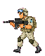 | Штурмовик | Идёт к базе и бьёт в упор. С 1-й волны. |
| 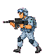 | Стрелок | Встаёт на середине поля и стреляет. С 3-й волны. |
| 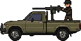 | Пикап | Едет к рубежу стрелка и бьёт из пулемёта в кузове. С 11-й волны. |
| 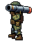 | Ракетчик | Доходит до трёх четвертей поля и пускает ракеты. С 21-й волны. |
| 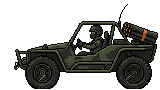 | Багги | Стоит у правого края и бьёт самонаводящимися ракетами. С 31-й волны. |
| 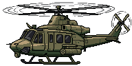 | Вертолёт | Летает над дальней четвертью поля и чередует ракеты с пулемётом. С 41-й волны. |

Урон штурмовика, стрелка, ракетчика, пикапа, багги и вертолёта растёт на 1 каждые 10 волн: на 10-й уже +1, на 20-й +2. Ниже написана база, без этой прибавки.

- **Штурмовик** — с 1-й волны. Идёт к танку и бьёт базу в упор на 12 здоровья. Убийство даёт 1 монету. У стены он взрывается, трупа на земле не остаётся.
- **Стрелок** — с 3-й волны. Останавливается на середине исходного поля (x = 640). Пуля снимает 8 здоровья. До 20-й волны стреляет одиночными раз в 1,5 с. Каждые 20 волн в очередь добавляется одна пуля, больше трёх не бывает: с 20-й две, с 40-й три. Между пулями 0,15 с, после последней снова 1,5 с. 20-я и 40-я — боссы, поэтому две пули впервые на 21-й, три на 41-й. 2 монеты.
- **Пикап** — дебют записан на 10-й волне. Сама 10-я — босс, поэтому первая машина выходит со следующей обычной волны и уже со здоровьем 2. Едет быстрее солдат, встаёт на той же линии, что стрелок, и даёт очередь из пяти пуль по 2 урона, затем три секунды тишины. 3 монеты. Артиллерия, мина, РСЗО и бомбардировщик разнимают сгоревший корпус пополам: колёса отваливаются, пулемёт с кузова лежит рядом. Ионная пушка режет тот же сгоревший корпус вдоль столба, дым с капота остаётся на своей половине. Пушка, пулемёт и огонь оставляют целый сгоревший корпус.
- **Ракетчик** — дебют записан на 20-й волне. На экран он выходит со следующей обычной волны, первый раз со здоровьем 2. Доходит до трёх четвертей ширины поля, садится на колено и пускает ракету раз в 3 с на 3 урона. 3 монеты.
- **Багги** — дебют записан на 30-й волне. Сама 30-я — босс, поэтому первая машина выходит со следующей обычной волны и уже со здоровьем 2. Едет быстрее солдат и встаёт у правого края поля, кормой внутрь на 6 px. Залп самонаводящихся ракет по 3 урона: две, пока номер волны меньше 10, дальше +1 каждые 10 волн и не больше восьми (с 10-й три, с 60-й восемь). На 31-й это уже пять. Между ракетами 0,4 с, после последней 3 с. Каждая выходит из своей трубки и держит свой изгиб, к танку они сходятся уже рядом с ним. Ракета задирает нос и доворачивает, за край поля не уходит. Сзади своей трубки на пуске вспыхивает огонь вдоль блока. При гибели остаётся сгоревший корпус и та же вспышка, что у пикапа. Артиллерия, мина, РСЗО и бомбардировщик разнимают его пополам, колёса отваливаются. Ионная пушка режет тот же корпус вдоль столба, дым с капота остаётся на своей половине. Пушка, пулемёт и огонь оставляют целый сгоревший корпус. 3 монеты.
- **Вертолёт** — дебют записан на 40-й волне. Сама 40-я — босс, поэтому первая машина выходит со следующей обычной волны и уже со здоровьем 2. Летает по дальней четверти поля и не заходит левее трёх четвертей его ширины. Под полозьями на траве лежит тень, ниже корпуса: по зазору видно, что машина в воздухе. Несущий и хвостовой винты крутятся. Долетев до точки, зависает и дважды выпускает полный залп одного оружия. Между залпами 2 с. После последнего ещё 0,5 с, потом летит в другую. Ракеты и пулемёт не стреляют вместе: следующее зависание — другой вид. Ракеты самонаводящиеся, того же размера, что у багги, по 3 урона. Выходят по одной, между ними 0,4 с. На волне дебюта их четыре, дальше +1 каждые 10 волн и не больше восьми (с 80-й восемь). На 41-й всё ещё четыре. Пулемёт под носом крутится в сторону танка. Очередь пуль по 2 урона, между ними 0,15 с. На дебюте четыре патрона, дальше +1 каждые 10 волн и не больше десяти (с 100-й десять). На 41-й четыре. Каждая пуля выбрасывает гильзу. Ракеты сбиваются, как ракеты багги. Сам вертолёт теряет здоровье от снаряда танка, пулемёта на башне, ионной пушки и атомного взрыва. При гибели та же вспышка, что у багги: корпус падает в точку своей тени и остаётся сгоревшим остовом, на кабине огонь и дым. Ионная пушка режет его в воздухе, половины падают туда же и ложатся уже разрезанным остовом под наклоном, огонь и дым на каждой. 3 монеты.

### Боссы

| Картинка | Название | Краткое описание |
| :---: | --- | --- |
| 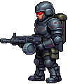 | Суперсолдат | Босс 10-й, 30-й, 50-й… Бегает по полю и даёт очередь, до танка не доходит. |
| 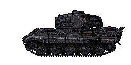 | Тяжёлый танк | Босс 20-й, 40-й, 60-й… Едет напротив танка игрока к середине поля и бьёт из пушки. |

- **Суперсолдат** — босс нечётных десятков: 10, 30, 50…. Сначала на поле один. Каждые три босс-волны добавляется ещё одно тело, больше пяти не бывает: на 10–30-й одно, на 40–60-й два, на 70–90-й три, на 100–120-й четыре, со 130-й пять. Со второго тела чётные места очереди занимает ведущий босс этой волны, нечётные — другой. Тяжёлый танк на волне всегда один: место второго танка занимает суперсолдат. На 40-й это тяжёлый танк и суперсолдат, на 50-й суперсолдат и тяжёлый танк. Он крупнее пехоты. Здоровье считается по номеру босс-волны: первая такая волна 100, дальше +500 (на 30-й 1100, на 50-й 2100). Урон пули тоже: первая босс-волна бьёт на 1, 30-я на 3, 50-я на 5. Касса волны — 25 монет за номер босс-волны: на 10-й это 25, на 20-й 50, на 40-й 100 на двоих. Все тела волны, и танк тоже, делят кассу поровну, остаток в одну монету получают первые в очереди. Каждые 5 секунд бегает в случайную точку и даёт очередь из пяти пуль. До танка не доходит.
- **Тяжёлый танк** — босс чётных десятков: 20, 40, 60…. На поле всегда один. Со 40-й делит волну с суперсолдатом, как сказано выше. Едет от правого края по линии танка игрока к середине поля (x = 640) и там встаёт. Пока едет, пушка молчит, гусеница крутится и оставляет две колеи сразу на всю длину ленты, без разрыва у переднего края. Каждая толщиной с ленту гусеницы: одна по верху катков, другая по подошве, на высоту хода на рисунке. Проехавший след остаётся позади сплошной полосой, пока танк жив. После обновления страницы колеи рисуются снова от правого края поля до танка: он всегда едет оттуда. При гибели колеи гаснут за 0,5 с. Корпус дрожит от мотора, с кормы идёт чёрный дым на юго-восток. Пока корпус жив, мотор гудит. Лязг гусениц слышен только на ходу: на рубеже и под ЭМИ его нет. На рубеже стреляет сразу, дальше раз в 4 с прямой наводкой. Снаряд летит в танк игрока, лазер его не сбивает. Попадание в танк играет взрыв из листа: вспышка, огонь и серый дым, и тот же разрыв, что у артиллерии (`public/audio/artillery_explosion.mp3`). Первый выход снимает 50 здоровья, каждый следующий выход танка прибавляет 1 (на 40-й это 51, на 50-й 52). Здоровье первого выхода 2000, дальше +500 за каждый следующий выход танка (на 40-й 2500, на 50-й 3000). Ствол при выстреле отскакивает в башню, с задней части башни вылетает гильза. При гибели остаётся сгоревший корпус, над проломом башни идёт дым. Ионная пушка режет этот корпус вдоль столба, остальное оружие оставляет его целым. До проволоки не доходит. Доля кассы та же, что у суперсолдата на этой волне.

### Скиллы

| Картинка | Название | Краткое описание |
| :---: | --- | --- |
| 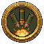 | Артиллерийский удар | Роняет снаряды в случайные точки поля. Клавиша `1`. |
| 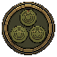 | Мины | Ставит заряды, которые ждут пехоту. Клавиша `2`. |
| 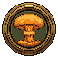 | Атомный взрыв | Бомба в центр поля убивает всех, кто уже в кадре. Клавиша `3`. |
| 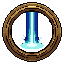 | Ионная пушка | Столб энергии проходит по полю и накрывает тех, кто под пятном. Клавиша `4`. |
|  | Энергетическая стена | Завеса перед проволокой забирает урон по базе, пока стоит. Клавиша `5`. |
| 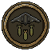 | Бомбардировщик | Самолёт пролетает над полем и роняет бомбы по одной линии. Клавиша `6`. |
|  | ЭМИ | Луч к земле в середине поля и полусфера на всё поле. Пехота и техника замирают, летящие ракеты рвутся. Урона нет. Клавиша `7`. |
| 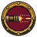 | Автострельба | Танк стреляет сам. |
| 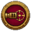 | Автонаведение | Башня держит ближайшего врага, пока он жив. |
| 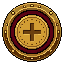 | Автопокупка | После волны сама тратит монеты и начинает следующую. |

### Защитная техника

| Картинка | Название | Краткое описание |
| :---: | --- | --- |
|  | Пулемёт | Ствол на башне стреляет вдоль прицела. |
| 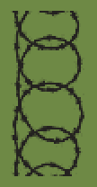 | Колючая проволока | Полоса перед танком не пускает пехоту к базе и ранит её. |
| 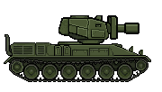 | Огнемёт | Башня ведёт струю по дуге, на земле остаётся огонь. |
| 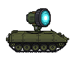 | Лазерная установка | Сбивает ракету, которая уже летит. |
| 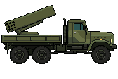 | РСЗО | Сама пускает ракеты в дальнюю половину поля. |

### Как собирается волна

Список считает `src/entities/EnemyFactory.ts`. Он заново проигрывает волны с 1-й до текущей и складывает отряд:

1. Волна 1 выпускает 5 штурмовиков.
2. Каждая волна до стрелка добавляет ещё одного штурмовика. На 2-й их уже шесть.
3. На 3-й волне к отряду добавляется стрелок.
4. Дальше новый враг добавляется каждые 5 волн: 8, 13, 18 и так далее. Вид берётся по кругу из тех, кто уже выходил: штурмовик, стрелок, затем пикап, затем ракетчик, затем багги, затем вертолёт.
5. Волна первого появления пикапа, ракетчика, багги и вертолёта записывает эту машину в историю отряда. Сама 10-я, 20-я, 30-я и 40-я волны на экран её не выпускают: в эти номера выходят боссы. Пикап попадает в круг с 11-й волны, ракетчик — с 21-й, багги — с 31-й, вертолёт — с 41-й.
6. В одной волне не больше 100 врагов. После потолка растут здоровье и скорость, число стоит на месте.

Здоровье штурмовика равно номеру волны. У стрелка, ракетчика, пикапа, багги и вертолёта ранг 1 на волне дебюта, дальше +1 за каждую волну. Скорость шага растёт вместе с этим рангом. Пикап, ракетчик, багги и вертолёт дебютируют на босс-волне, поэтому первый живой экземпляр уже с рангом 2. Клавиша `+` умножает уже посчитанную скорость.

Пауза между появлениями на 1-й волне — 340 мс. Каждая следующая волна короче на 28 мс, но короче 150 мс враги не выходят. Надпись «ВОЛНА» или «БОСС» с именем босса держится около 1,3 с, и только потом первый враг шагает на поле. На общей волне вторая строка называет обоих: «СУПЕРСОЛДАТ И ТЯЖЁЛЫЙ ТАНК».

### Магазин между волнами

Открывается, когда живых врагов не осталось и база цела. Сначала доигрывает последний разрыв, а если гриб атомного взрыва или вспышка авиабомбы ещё стоит — магазин ждёт, пока они погаснут. Пока окно на экране, физика стоит: солдаты и снаряды замирают. Покупки разложены по вкладкам. Число монет в правом верхнем углу и цена на карточке стоят за белым знаком.

Шесть кнопок на вкладке «Танк» можно жать много раз. Номер и цена — только покупки этой кнопки в партии. Постоянный уровень из магазина очков уже в числе на карточке, но лестницу цены не двигает: два уровня урона из очков оставляют первую цену 3, а не 4. Урон, взрыв и перезарядка: `округлить(3 × 1,15 в степени уровня партии)`. Первые цены — 3, 3, 4, 5, 5, 6…

- **+1 область взрыва** — радиус взрыва снаряда танка. Без покупок радиус 10. Уровни партии и прогресса вместе не выше 100, кнопка тогда пишет «максимум».
- **+1 урон** — урон этого снаряда. База снаряда — 1.
- **−0.02 с перезарядки** — пауза между выстрелами. В начале она 1 с. Магазин партии не опускает её ниже 0,2 с. Постоянная скорость сама останавливается на 0,5 с, и дальше добивает уже эта кнопка. Номер на кнопке — только покупки партии: без прогресса потолок 40, после полного прогресса добивка — ещё 15. Секунды на карточке уже с прогрессом.
- **−0.10 с полёта** — снаряд быстрее пересекает поле. В начале полёт 2 с: от дула до правого края поля 1280 это 555,5 пикселя в секунду. Магазин партии не опускает полёт ниже 0,40 с. Постоянная скорость сама останавливается на 0,60 с, и дальше добивает уже эта кнопка. Над полем время пишется рядом с огнём. Цена своей лестницей: `округлить(300 × 1,15 в степени уровня партии)` — 300, 345, 397…
- **+3 отталкивание** — снаряд сдвигает задетых врагов вправо. Стрелок, пикап, ракетчик и багги после сдвига идут обратно к своему рубежу и снова встают. Штурмовик, сбитый с проволоки, снова идёт к базе. Без покупок сдвига нет. Шаг партии — 3 px, вместе с прогрессом не больше 100. Цена своей лестницей: `округлить(100 × 1,15 в степени уровня партии)` — 100, 115, 132…
- **+1% пробивание** — шанс, что снаряд прошьёт первого врага на пути: урон без взрыва и без сдвига, разрыв и осколки достаются уже следующему. Без покупок шанса нет. Шаг — 1%. Партия и прогресс вместе не выше 70%. Прогресс сам не выше 50%. Над полем шанс пишется рядом с уроном. Цена как у отталкивания: `округлить(100 × 1,15 в степени уровня партии)` — 100, 115, 132…

Остальные вкладки покупают вещь один раз за партию. После установки у пулемёта, проволоки, огнемёта, РСЗО, артиллерии, ионной пушки, мин и бомбардировщика открывается **+1 урон** по той же формуле 3 × 1,15. Номер и цена — только покупки партии. Урон на карточке у пулемёта, проволоки, огнемёта, РСЗО, артиллерии, ионной пушки, мин и бомбардировщика уже с постоянным уровнем из магазина очков. У лазера и атомного взрыва числа урона нет. У артиллерии, ионной пушки, мин и атомного взрыва после покупки открывается **−1 с перезарядки**. У артиллерии, ионной пушки и мин магазин волны снимает не больше 20 с и сам останавливается на 40 с. Секунды магазина очков из этого запаса не вычитаются: у каждого магазина свои 20 с, вместе не короче 20 с. У атомного взрыва минус 1 с, пока откат не станет 2 минуты, и секунды из магазина очков из этого запаса уже вычтены. Цена у всех четырёх своей лестницей: `округлить(1000 × 1,15 в степени уровня партии)` — 1000, 1150, 1323…

У ионной пушки после покупки открывается ещё **−0.10 с хода**. Пятно в начале идёт 5 с. Магазин партии снимает не больше 1 с шагом 0,10 с и сам останавливается на 4 с. Магазин очков снимает свою 1 с шагом 0,20 с. Вместе не короче 3 с. Секунды на карточке уже с прогрессом. Цена: `округлить(500 × 1,15 в степени уровня партии)` — 500, 575, 661…

У бомбардировщика после покупки открывается **−0,1 мин перезарядки**. Откат в начале 3 минуты. Магазин волны и магазин очков снимают по 1 минуте шагом 0,1 минуты и сами останавливаются на 2:00. Минуты магазина очков из этого запаса не вычитаются: у каждого магазина своя минута, вместе не короче 1:00. Цена своей лестницей: `округлить(1000 × 1,15 в степени уровня партии)` — 1000, 1150, 1323…

У ЭМИ после покупки открываются **−1 с перезарядки** и **+0.10 с оглушения**. Откат в начале 3 минуты. Магазин волны и магазин очков снимают по 1 минуте шагом 1 с и сами останавливаются на 2:00. Секунды магазина очков из этого запаса не вычитаются: у каждого магазина своя минута, вместе не короче 1:00. Цена отката: `округлить(1000 × 1,15 в степени уровня партии)` — 1000, 1150, 1323… Оглушение в начале 2 с. Каждый магазин прибавляет 0,5 с шагом 0,10 с, вместе не дольше 3 с. Цена оглушения той же лестницей: `округлить(1000 × 1,15 в степени уровня партии)` — 1000, 1150, 1323…

У энергетической стены после покупки открываются **+0.10 с длительности** и **−0.10 с перезарядки**. Завеса в начале стоит 1 с. Магазин партии прибавляет не больше 1 с шагом 0,10 с и сам останавливается на 2 с. Магазин очков прибавляет свою 1 с тем же шагом. Вместе не дольше 3 с. Секунды на карточке уже с прогрессом. Цена длительности: `округлить(500 × 1,15 в степени уровня партии)` — 500, 575, 661… Откат в начале 3 минуты. Магазин партии снимает не больше 0,5 с шагом 0,10 с. Магазин очков снимает свои 0,5 с тем же шагом. Вместе не короче 2:59. Цена отката: `округлить(1000 × 1,15 в степени уровня партии)` — 1000, 1150, 1323…

У пулемёта после установки открываются ещё **−0.02 с перезарядки** и **−0.10 с полёта**. Пауза в начале 3 с. Магазин партии не опускает её ниже 0,2 с. Постоянная скорость сама останавливается на 0,5 с, и дальше добивает уже эта кнопка. Номер на кнопке — только покупки партии: без прогресса потолок 140, после полного прогресса добивка — ещё 15. Секунды на карточке уже с прогрессом. Цена та же, что у перезарядки танка, и прогресс в неё не входит. Полёт в начале 2 с: нарисованное поле 1280 пуля проходит за 640 пикселей в секунду. Магазин партии не опускает полёт ниже 0,40 с. Постоянная скорость сама останавливается на 0,60 с, и дальше добивает уже эта кнопка. Цена как у полёта снаряда: `округлить(300 × 1,15 в степени уровня партии)` — 300, 345, 397…

| Покупка | Цена | Эффект |
| --- | --- | --- |
| Пулемёт | 100 | Ствол на башне, пуля раз в 3 с на 1 урон вдоль прицела. Полёт через поле 1280 — 2 с. После установки открываются перезарядка и полёт по тем же шагам, что у снаряда. Магазин очков добавляет пули, урон, перезарядку и полёт |
| Колючая проволока | 50 | Полоса перед танком. Пехота, которая идёт к базе, упирается в неё и раз в 3 секунды получает 1 урон. Магазин очков добавляет урон |
| Огнемёт | 1000 | Раз в 10 с башня ведёт струю сверху вниз на четверть ширины поля. Струя и огонь на земле бьют на 8. Магазин очков добавляет урон. Костёр поджигает врага, который ещё не горит, и уже горящего не продлевает. Горение держится 2 с и каждую секунду снимает 2: 20% базовых 8 округляются вверх. Покупка урона это число не поднимает. Костры держатся 2 с и потом сжимаются |
| Лазерная установка | 1000 | Сбивает ракету, которая уже летит хотя бы 0,2 с. Луч раз в 3 с, магазин очков укорачивает до 1 с. Пустое небо перезарядку не тратит. Магазин очков добавляет лучи в очередь |
| РСЗО | 1000 | Сама пускает 3 ракеты по 20 урона раз в 5 с в дальнюю половину поля. Магазин очков поднимает залп до 8 и добавляет урон |
| Артиллерийский удар | 100 | Клавиша `1` или иконка роняет три снаряда по 20 урона. Магазин очков поднимает залп до 6 и добавляет урон. Перезарядка 1 минута. Магазин волны и магазин очков снимают по 20 с, вместе не короче 20 с. Воронка лежит 5 с. Автоприменение за 20000 очков роняет залп само через секунду после готовности |
| Ионная пушка | 100 | Клавиша `4` или иконка пускает столб энергии с неба. Столб падает сверху. В момент удара о землю вспыхивает белое пятно и тут же гаснет. Дальше столб держится, пока идёт по полю, и уходит вверх. Пятно появляется у края поля, отступив внутрь так, чтобы воронка в этой точке была видна целиком, и без покупок за 5 с доходит до другого края. Магазин волны снимает 1 с шагом 0,10 с, магазин очков — 1 с шагом 0,20 с, вместе не короче 3 с. Путь не короче половины ширины поля. В момент пуска прямая проложена через одного живого врага и дальше за ним не идёт. Если врагов нет, оба края случайные. Купленная колючая проволока закрывает левый край: луч не встаёт за ней и, если идёт в её сторону, кончается перед ней. Под пятном остаётся выжженная полоса, как от огнемёта. В точке появления остаётся воронка артиллерийского удара. Полоса и воронка исчезают через 3 с после того, как столб погас. Подошва пятна даёт 50 урона в момент накрытия и дальше каждые 0,1 с, пока цель под ней. У пикапа и суперсолдата она задевает весь корпус, не только середину. Столб, проходя мимо, не бьёт. Убитый расходится на две половины картинки вдоль столба. Половинки пехоты падают на землю. Магазин очков добавляет урон. Перезарядка 1 минута. Магазин волны и магазин очков снимают по 20 с, вместе не короче 20 с. Автоприменение за 20000 очков пускает луч само через секунду после готовности |
| Мины | 100 | Клавиша `2` или иконка ставит три заряда по 10 урона. Магазин очков поднимает постановку до 6 и добавляет урон. Лежат, пока на них не наступит пехота. Если холст стал уже и заряд оказался правее нового края, он сдвигается влево по своей высоте и не ложится на соседний. Перезарядка 1 минута. Магазин волны и магазин очков снимают по 20 с, вместе не короче 20 с. Воронка лежит 3 с. Автоприменение за 20000 очков ставит заряды само через секунду после готовности |
| Атомный взрыв | 500 | Клавиша `3` или иконка роняет бомбу в центр поля. Взрыв убивает всех, кто уже в кадре. Перезарядка 3 минуты, вместе с магазином очков не короче 2 минут. Воронка лежит 5 с |
| Энергетическая стена | 100 | Клавиша `5` или иконка ставит завесу перед колючей проволокой, от верха поля до баннера. Пока она стоит, база не теряет здоровье: пули и ракеты гаснут на завесе, удар штурмовика в упор урона не наносит. Без покупок завеса держится 1 с. Магазин волны и магазин очков прибавляют по 1 с шагом 0,10 с, вместе не дольше 3 с. Перезарядка 3 минуты. Каждый магазин снимает 0,5 с шагом 0,10 с, вместе не короче 2:59. В момент включения играет тот же клип, что у лазера. Автоприменение за 20000 очков ставит завесу само через секунду после готовности, если в полёте есть пуля или ракета, которую завеса успеет погасить. Отскочивший выстрел откат не тратит |
| ЭМИ | 100 | Клавиша `7` или иконка бьёт лучом из верхней кромки к земле в середине поля. Затем из этой точки на всё поле расходится полусфера. Урона нет. Когда полусфера гаснет, пехота, включая суперсолдата, замирает. Над головой крутятся звёзды. Пикап, багги, вертолёт и тяжёлый танк тоже замирают, по корпусу бегут молнии. Без покупок это 2 с. Магазин волны и магазин очков прибавляют по 0,5 с шагом 0,10 с, вместе не дольше 3 с. Уже летящие ракеты ракетчика, багги, вертолёта и РСЗО рвутся в воздухе и урона не наносят. Пули и снаряд тяжёлого танка летят дальше. Перезарядка 3 минуты. Магазин волны и магазин очков снимают по 1 минуте шагом 1 с, вместе не короче 1:00. Появление играет низкий сход `public/audio/ion_appear.ogg`, тот же, что у ионного столба. Полусфера играет `public/audio/forceField_000.ogg`, когда всходит у земли. Если рвётся хотя бы одна ракета, играет клип её разрыва |
| Бомбардировщик | 1000 | Клавиша `6` или иконка пускает самолёт над полем слева направо. На одной линии он роняет бомбы по 100 урона от правого края того места, где встаёт энергостена, до правого края поля. Завеса при этом может не стоять. Шаг не шире 36 px, первая и последняя бомбы на этих краях. Чаша не заходит на сторону базы и не вылезает за край поля. На поле шириной 1280 это 26 бомб. Линия — высота случайного живого врага, а если живых нет — случайная высота в полосе врагов. Перезарядка 3 минуты. Магазин волны и магазин очков снимают по 1 минуте шагом 0,1 минуты, вместе не короче 1:00. Воронка лежит 5 с. Магазин очков добавляет урон. Автоприменение за 20000 очков пускает пролёт само через секунду после готовности |

«Следующая волна» закрывает окно и запускает бой. После покупки автопокупки за 50000 очков включённая иконка у правого края делает это сама: через секунду после открытия окна тратит монеты и закрывает магазин. Улучшения танка идут в порядке урон, перезарядка, взрыв, полёт, отталкивание, пробивание. Здоровье в этом магазине не продаётся. Если пулемёт уже стоит, после каждых трёх покупок танка берётся одно его улучшение: урон, перезарядка, полёт. Установки пулемёта и чужие постройки эта покупка не берёт. Выключенная иконка оставляет окно как есть.

Каждое убийство добавляет 10 очков и монеты этого врага. Постоянные «+1 монета» и «+1 очко» дописывают свои числа сверху.

### Поражение

Надпись «БАЗА РАЗБИТА» открывает магазин очков. Число очков в правом верхнем углу и цена на карточке стоят за белым знаком. Очки этой партии прибавляются к запасу в браузере (`localStorage`) и переживают перезагрузку. Вкладки: «Танк», «Пулемёт», «Колючая проволока», «Огнемёт», «Лазерная установка», «РСЗО», «Артиллерия», «Ионная пушка», «Мина», «Атомный взрыв», «Энергетическая стена», «Бомбардировщик», «ЭМИ», «Ресурсы».

У танка, монет, очков и лучей первая покупка стоит 500, каждая следующая того же улучшения дороже на 500: 500, 1000, 1500…

- **+1 урон** — складывается с уроном магазина партии
- **+1 взрыв** — складывается с радиусом магазина партии. Прогресс сам не выше 50
- **−0.01 с перезарядки** — поверх магазина партии, но не короче 0,50 с. До 0,20 с добивает уже магазин волны
- **−0.10 с полёта** — поверх магазина партии, но не короче 0,60 с. До 0,40 с добивает уже магазин волны
- **+1 отталкивание** — +1 px к сдвигу снаряда. Прогресс сам не выше 50. Цена как у урона пули: 300, 600, 900…
- **+1% пробивание** — +1% к шансу прошивания. Прогресс сам не выше 50. Цена как у отталкивания: 300, 600, 900…
- **+1% поглощение урона** — шанс, что патрон или снаряд врага не нанесёт урон танку и отрикошетит от танка в случайную сторону от грани, в которую вошёл. По пути он ранит каждого врага, до которого долетает, уроном этого выстрела, и пропадает за краем поля. Очередь проверяет каждый патрон и каждый снаряд отдельно. Без покупок шанса нет. Шаг — 1%, выше 30% прогресс не ставит. Первая покупка стоит 1000 очков, каждая следующая того же улучшения дороже на 1000: 1000, 2000, 3000…
- **+10 здоровья** — запас новой партии. Без покупок 100. Каждый уровень прибавляет 10, выше 500 прогресс не ставит. Первая покупка стоит 1000 очков, каждая следующая того же улучшения дороже на 1000: 1000, 2000, 3000…
- **автострельба** — одна покупка за 5000 очков. Танк стреляет сам. Иконка включает и выключает режим и стоит вплотную слева от купленных автонаведения и автопокупки, а если их нет — у правого края. Свежая покупка сразу включена. Покупка переживает гибель базы
- **автонаведение** — одна покупка за 50000 очков. Башня сама держит ближайшего врага и не бросает его, пока он жив. Иконка включает и выключает режим. Она у правого края, пока нет автопокупки; купленная автопокупка занимает край, и этот круг сдвигается влево вплотную. Пока живых нет, башню снова ведёт курсор
- **автоприменение артиллерии** — одна покупка за 20000 очков на вкладке «Артиллерия». Удар сам через секунду после готовности. Секунда идёт и в магазине волны, сам удар выходит, когда магазин закрыт. Выключатель на иконке удара включает и выключает режим, свежая покупка сразу включена
- **автоприменение ионной пушки** — одна покупка за 20000 очков на вкладке «Ионная пушка». Луч сам через секунду после готовности. Секунда идёт и в магазине волны, сам луч выходит, когда магазин закрыт. Уже пущенный столб в магазине не замирает. Выключатель на иконке луча включает и выключает режим, свежая покупка сразу включена
- **автоприменение мин** — одна покупка за 20000 очков на вкладке «Мина». Постановка сама через секунду после готовности. Секунда идёт и в магазине волны, сами мины встают, когда магазин закрыт. Выключатель на иконке мин включает и выключает режим, свежая покупка сразу включена
- **автоприменение бомбардировщика** — одна покупка за 20000 очков на вкладке «Бомбардировщик». Пролёт сам через секунду после готовности. Секунда идёт и в магазине волны, сам пролёт выходит, когда магазин закрыт. Уже летящий самолёт в магазине не замирает. Выключатель на иконке бомбардировщика включает и выключает режим, свежая покупка сразу включена
- **автоприменение энергетической стены** — одна покупка за 20000 очков на вкладке «Энергетическая стена». Завеса сама через секунду после готовности, и только если в полёте есть пуля или ракета, которая дойдёт до правого края завесы, пока та стоит. Уже левее края входящий выстрел гаснет сразу. Отскочивший выстрел завеса не гасит и откат не тратит. Секунда идёт и в магазине волны, сама завеса встаёт, когда магазин закрыт. Пока такого выстрела нет, откат не начинается и проверка повторяется. Уже стоящая стена в магазине не замирает. Выключатель на иконке стены включает и выключает режим, свежая покупка сразу включена
- **+1 монета за убийство**
- **+1 очко** — сверху базовых 10 за убийство
- **автопокупка** — одна покупка за 50000 очков на вкладке «Ресурсы». Иконка справа на ряду способностей включает и выключает режим, свежая покупка сразу включена. Включённая через секунду после магазина волны тратит монеты: три улучшения танка, затем одно уже стоящего пулемёта, и сама переходит к следующей волне. Покупка переживает гибель базы

Пули пулемёта считаются отдельно. Первая дополнительная стоит 100, дальше 200, 300… Без покупок пуля одна, десятая — потолок. Урон пули: первая прибавка 300, дальше 600, 900… Она складывается с уроном пули из магазина партии.

**−0.01 с перезарядки** пулемёта — поверх магазина партии, но не короче 0,50 с. До 0,20 с добивает уже магазин волны. В начале пауза 3 с. Цена как у перезарядки танка: 500, 1000, 1500…

**−0.10 с полёта** пули — поверх магазина партии, но не короче 0,60 с. До 0,40 с добивает уже магазин волны. В начале полёт 2 с. Цена та же: 500, 1000, 1500…

Лучи лазера идут по цене 500. Без покупок луч один, третий — потолок.

Перезарядка лазера. Каждый уровень снимает 1 с. Первая секунда стоит 5000 очков, вторая — 50000. Без покупок луч раз в 3 с, короче 1 с прогресс не ставит.

Ракеты РСЗО, снаряды артиллерии и мины считаются одинаково и отдельно друг от друга. Первая покупка стоит 1000 очков, каждая следующая того же улучшения дороже на 1000: 1000, 2000, 3000… Без покупок в залпе три. Ракеты доходят до восьми, снаряды и мины — до шести.

Урон этих трёх, ионной пушки и бомбардировщика считается так же отдельно. Первая прибавка стоит 300 очков, дальше 600, 900… Она складывается с уроном магазина партии. Потолка нет.

Урон колючей проволоки считается так же. Первая прибавка стоит 300 очков, дальше 600, 900… Она складывается с уроном магазина партии. Потолка нет.

Урон огнемёта считается так же. Первая прибавка стоит 300 очков, дальше 600, 900… Она складывается с уроном магазина партии и поднимает струю и огонь на земле. Горение остаётся 2. Потолка нет.

Перезарядка артиллерии, ионной пушки и мин считается одинаково и отдельно друг от друга. Каждый уровень снимает 1 с. Первая покупка стоит 500 очков, каждая следующая того же улучшения дороже на 500: 500, 1000, 1500… Прогресс сам снимает не больше 20 с и останавливается на 40 с. Магазин волны снимает свои 20 с: без очков это до 40 с, с полными 20 с прогресса — до 20 с. Цена там своя: `округлить(1000 × 1,15 в степени уровня партии)` — 1000, 1150, 1323… Если свой запас секунд уже выбран, кнопка прогресса пишет «макс.»: шаг ничего не укорачивает.

Ход ионной пушки считается отдельно. Каждый уровень снимает 0,2 с. Первая покупка стоит 500 очков, каждая следующая того же улучшения дороже на 500: 500, 1000, 1500… Прогресс сам снимает не больше 1 с и останавливается на 4 с. Магазин волны снимает свою 1 с шагом 0,1 с: без очков это до 4 с, с полной секундой прогресса — до 3 с. Цена там своя: `округлить(500 × 1,15 в степени уровня партии)` — 500, 575, 661… Если свой запас секунд уже выбран, кнопка прогресса пишет «макс.».

Ширина ионной пушки считается отдельно. Каждый уровень расширяет столб и его подошву на 10%. Первая покупка стоит 3000 очков, каждая следующая того же улучшения дороже на 3000: 3000, 6000, 9000… Потолок — 2,5 раза от базовой ширины. Дальше кнопка пишет «макс.». У пикапа, багги, суперсолдата и тяжёлого танка подошва по-прежнему берёт весь корпус, если он шире столба.

Перезарядка бомбардировщика считается отдельно. Каждый уровень снимает 0,1 минуты. Первая покупка стоит 500 очков, каждая следующая того же улучшения дороже на 500: 500, 1000, 1500… Прогресс сам снимает не больше 1 минуты и останавливается на 2:00. Магазин волны снимает свою минуту шагом 0,1 минуты: без очков это до 2:00, с полной минутой прогресса — до 1:00. Цена там своя: `округлить(1000 × 1,15 в степени уровня партии)` — 1000, 1150, 1323… Если свой запас уже выбран, кнопка прогресса пишет «макс.»: шаг ничего не укорачивает.

Перезарядка атомного взрыва считается отдельно. Каждый уровень снимает 1 с. Первая покупка стоит 500 очков, каждая следующая того же улучшения дороже на 500: 500, 1000, 1500… Прогресс сам снимает не больше 30 с и останавливается на 2:30. Магазин волны добивает остаток до 2 минут: без очков это 60 с, с полной полминутой прогресса — ещё 30 с. Цена там своя: `округлить(1000 × 1,15 в степени уровня партии)` — 1000, 1150, 1323… Если партия уже довела откат до 2 минут, кнопка прогресса пишет «макс.»: шаг ничего не укорачивает.

Длительность энергетической стены считается отдельно. Каждый уровень прибавляет 0,1 с. Первая покупка стоит 2000 очков, каждая следующая того же улучшения дороже на 2000: 2000, 4000, 6000… Прогресс сам прибавляет не больше 1 с и останавливается на 2 с. Магазин волны прибавляет свою 1 с шагом 0,1 с: без очков это до 2 с, с полной секундой прогресса — до 3 с. Цена там своя: `округлить(500 × 1,15 в степени уровня партии)` — 500, 575, 661… Если свой запас секунд уже выбран, кнопка прогресса пишет «макс.».

Перезарядка ЭМИ считается отдельно. Каждый уровень снимает 1 с. Первая покупка стоит 500 очков, каждая следующая того же улучшения дороже на 500: 500, 1000, 1500… Прогресс сам снимает не больше 1 минуты и останавливается на 2:00. Магазин волны снимает свою минуту шагом 1 с: без очков это до 2:00, с полной минутой прогресса — до 1:00. Цена там своя: `округлить(1000 × 1,15 в степени уровня партии)` — 1000, 1150, 1323… Если свой запас уже выбран, кнопка прогресса пишет «макс.».

Оглушение ЭМИ считается отдельно. Каждый уровень прибавляет 0,1 с. Первая покупка стоит 500 очков, каждая следующая того же улучшения дороже на 500: 500, 1000, 1500… Прогресс сам прибавляет не больше 0,5 с и останавливается на 2,5 с. Магазин волны прибавляет свои 0,5 с шагом 0,1 с: без очков это до 2,5 с, с полной половиной секунды прогресса — до 3 с. Цена там своя: `округлить(1000 × 1,15 в степени уровня партии)` — 1000, 1150, 1323… Если свой запас уже выбран, кнопка прогресса пишет «макс.».

Перезарядка энергетической стены считается отдельно. Каждый уровень снимает 0,1 с. Первая покупка стоит 3000 очков, каждая следующая того же улучшения дороже на 3000: 3000, 6000, 9000… Прогресс сам снимает не больше 0,5 с и останавливается на 2:59,5. Магазин волны снимает свои 0,5 с шагом 0,1 с: без очков это до 2:59,5, с полной половиной секунды прогресса — до 2:59. Цена там своя: `округлить(1000 × 1,15 в степени уровня партии)` — 1000, 1150, 1323… Если свой запас уже выбран, кнопка прогресса пишет «макс.».

«В бой» начинает новую партию и оставляет эти уровни. «Новая игра» обнуляет очки и уровни. Монеты, постройки и покупки между волнами живут только внутри партии: при гибели базы их сохранение стирается.

### Сохранение партии

Текущая волна, здоровье, монеты, очки партии, покупки магазина, темп, живые враги, лежащие мины, стена огня и перезарядка артиллерии, ионной пушки, мин, атомного взрыва, энергетической стены, бомбардировщика, ЭМИ и огнемёта пишутся в `localStorage`. Летящий самолёт и падающие бомбы в запись не входят: после загрузки пролёта на поле нет. Стоящая завеса в запись не входит: после загрузки её на поле нет. Идущий луч в запись не входит: после загрузки его на поле нет. Идущая вспышка ЭМИ в запись не входит: после загрузки её на поле нет. Обновление страницы продолжает тот же бой. Колеи тяжёлого танка в запись не входят: после загрузки он рисует их снова от правого края поля до своего места. Летящие снаряды в запись не входят: после загрузки враги стреляют заново. Уход на другую вкладку записывает партию. Пауза при этом ставится, если в настройках включена «Пауза при потере фокуса» — она включена, пока её не выключат. Если уже открыты настройки, они остаются: плашку паузы поверх не ставят. Пока идёт экран «БАЗА РАЗБИТА», партия уже стёрта, и автозапись молчит.

## Как устроен код

Законы проекта — в `docs/constitution.md`. Кто за что отвечает — в `docs/architecture.md`. Исходники ниже читают по порядку. В начале файла есть комментарий, зачем он нужен. Дальше комментарии идут по строкам: что делает вызов Phaser и какое правило игры за ним стоит.

1. `index.html` и `src/main.ts` запускают Phaser. Размер холста, подгонка под окно и темп врагов лежат в `src/gameConfig.ts`. Шрифт подключает `src/ui/gameFont.ts` из `public/fonts`, до старта игры.
2. `src/scenes/GameScene.ts` собирает партию. `create()` создаёт системы один раз. `update()` каждый кадр вызывает их по очереди, а ещё держит паузу и запись сохранения. Дебаг-партия — наследники тех же классов, их включает `src/scenes/GameSceneFactory.ts`.
3. `src/systems/` — правила боя. Сцена их вызывает, сама почти ничего не рисует.
   - `CombatSystem` — снаряды танка, пулемёт, лазер, огнемёт, РСЗО, взрывы, проволока, артиллерия, бомбардировщик, ионная пушка, мины, атомный взрыв, энергетическая стена и ЭМИ.
   - `ProjectileSystem` — пули и ракеты, которые летят в танк. Поглощение отводит патрон без урона. Стоящая стена гасит выстрел на своём крае.
   - `WaveManager` — надпись волны, выход врагов и магазин после зачистки.
4. `src/controllers/` — игрок, пауза и оба магазина.
   - `PlayerController` — танк и здоровье базы. Запас новой партии начинает со 100, его держит `src/entities/Tank/TankBaseHp.ts`. Магазин очков поднимает запас шагами по 10 до 500.
   - `ShopController` — магазин между волнами. Окно только рисует карточки.
   - `ProgressShopController` — магазин после поражения.
   - `PauseStack` и `ScreenPause` — пауза по `Esc`, кнопке и уходу на другую вкладку. Уход ставит паузу, только если в настройках включён переключатель. Флаг держит `FocusPause`.
5. `src/sounds/` — музыка и эффекты. Громкость эффектов общая, `EffectsVolume`, и пишется в `localStorage` отдельно от музыки. На паузе и после гибели базы клипы останавливаются. Взрыв базы доигрывает уже на экране очков.
   - `BattleMusic` — луп обычной волны (`public/audio/TRACK_01.mp3`) и луп босса (`public/audio/boss.mp3`).
   - `TankShot`, `TankMgShot`, `LaserShot` — пушка, пулемёт башни и луч. Энергетическая стена в момент включения берёт тот же клип, что лазер.
   - `Descent` — низкий сход сверху (`public/audio/ion_appear.ogg`). Его берут пуск ионного столба и появление вспышки ЭМИ.
   - `EmpSpread` — расширение полусферы ЭМИ (`public/audio/forceField_000.ogg`). Играет, когда купол всходит у земли.
   - `IonCannonSounds` — удар подошвы ионного столба в землю и шипение, пока столб идёт. Шипение обрывается, когда ход кончается.
   - `GunnerShot` и `BulletHitTank` — хлопок вражеской пули и удар о броню. Стрелок, пикап, вертолёт и суперсолдат. Ракета эти звуки не берёт. Багги и ракетный залп вертолёта тоже: у них пуск ракеты. Тяжёлый танк берёт хлопок артиллерии.
   - `HeavyTankSounds` — гул мотора тяжёлого танка, пока корпус жив (`public/audio/heavy-tank-boss-engine.mp3`), и лязг гусениц, только пока он едет (`public/audio/heavy-tank-boss-tracks.mp3`). На рубеже и под ЭМИ гусеницы молчат.
   - `RocketSounds` — пуск ракеты и взрыв о броню. `RocketBurst` — разрыв ракеты, сбитой лазером.
   - `BoomSounds` — хлопок артиллерии и общий разрыв `public/audio/artillery_explosion.mp3`: артиллерия, мины, бомбардировщик и попадание снаряда тяжёлого танка.
   - `NuclearExplosion`, `AssaultExplosion`, `VehicleExplosion`, `TankDeath` — атомный взрыв, штурмовик о броню, гибель пикапа, багги и вертолёта, гибель базы.
   - `ImpactSounds` — удар снаряда и пули пулемёта по врагу, один из трёх файлов `impact0.mp3`, `impact1.mp3`, `impact2.mp3`.
   - `InfantryDeath` — крик пехоты, убитой танком, один из двух файлов. Пикап, багги, вертолёт и штурмовик, дошедший до базы, этот звук не берут.
   - Общий список и пауза — `BattleEffects`.
6. `src/entities/` — то, что стоит на поле.
   - `Tank/Tank.ts` — корпус, башня и ствол.
   - `Infantry` — общий предок врагов: шаг, здоровье, полоска HP. Сам на поле не появляется.
   - `AssaultInfantry`, `GunnerInfantry`, `RocketInfantry`, `PickupTruck`, `RocketBuggy`, `Helicopter`, `SuperSoldier` — виды врагов. `BuggyRocket` — самонаводящаяся ракета багги и вертолёта.
   - `RangedEnemy` — общая стрельба для тех, кто доходит до рубежа и встаёт. Суперсолдат и вертолёт этот класс не наследуют: у каждого свой цикл.
   - `EnemyFactory` — кто именно выйдет в этой волне и с каким здоровьем.
   - `EnemyShot` и `Rocket` — вражеские снаряды.
   - `BarbedWire`, `MachineGun`, `LaserDefense`, `FlameTank`, `RocketSalvo`, `BomberStrike`, `IonCannon`, `Mines`, `NuclearStrike`, `EnergyWall` — покупки на поле. Иконки способностей лежат в `public`.
7. `src/abilities/` — способность игрока, не сосед на поле. `ArtilleryStrikeAbility` — числа залпа, падение снаряда и разрыв. `EmpFlashAbility` — числа ЭМИ, луч и полусфера. `AbilityList` — ряд иконок над лентой. `AutoFireAbilityIcon`, `AutoAimAbilityIcon`, `AutoShopAbilityIcon` — круги справа, покупка и выключатель лежат в прогрессе. `EnemyDamageDebugAbility` — флаг урона врагов, только дебаг-партия.
8. `src/ui/huds/GameHud.ts` — счёт, волна, монеты, полоска HP, баннер, иконки способностей, выключатели автоприменения на иконках артиллерии, ионной пушки, мин, энергетической стены и бомбардировщика, выключатели автострельбы, автонаведения и автопокупки, кнопка «КЛАВИШИ» и экран паузы. `src/ui/shops/ShopPanel.ts` и `ProgressShopPanel.ts` — витрины. В дебаге `DebugShopPanel.ts` и `DebugProgressShopPanel.ts` добавляют «+» слева от знака. Досыпку по `M` и «+» делают `DebugShopController` и `DebugProgressShopController`. `src/ui/settings/SettingsPanel.ts` — окно громкости и переключатель паузы при потере фокуса.
9. `src/gfx/` — цвета, рисование запасных спрайтов, огонь, воронки, гриб, разрыв авиабомбы, искры и разрез спрайта. `ensureGameTextures.ts` запекает картинки перед боем.
10. `src/saves/CombatSave.ts` — запись партии. `ProgressSave` — очки и постоянные уровни. `src/shopPrice.ts` подменяет любую цену на 1 в сборке `build:html:gift`.

Числа баланса лежат рядом с тем, кто их использует. Состав волны — `EnemyFactory.wave` и поле `debutWave` у врага. Выстрел танка — класс `Tank`. Перезарядка и полёт пулемёта — класс `MachineGun`. Разовые цены — поле `shop` у покупки. Откат и залп артиллерии — `ArtilleryStrikeAbilityConfig`. Откат и глушение ЭМИ — `EmpFlashAbilityConfig`. Повторяемая цена монет — `ShopController.upgradeCost`, `flightCost`, `knockbackCost` и `pierceCost`. Цены очков — `ProgressSave.cost`, `bulletCost`, `mgDamageCost`, `knockbackCost`, `pierceCost`, `countCost`, `autoFireCost`, `autoAimCost`, `autoShopCost`, `autoArtilleryCost`, `autoIonCost`, `autoMinesCost`, `autoBomberCost`, `autoWallCost`, `wallDurationCost`, `wallCooldownCost` и `empStunCost`.

Стек: [Phaser 4](https://phaser.io/), TypeScript, Vite.
