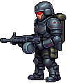
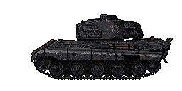
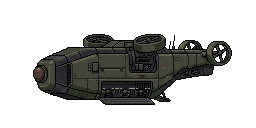
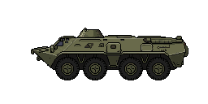
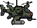

# Боссы

[Оглавление](../../README.md)

| Картинка | Название | Выход |
| :---: | --- | --- |
|  | Суперсолдат | На 10-й один. С 50-й босс нечётных десятков: 50, 70, 90… |
|  | Тяжёлый танк | На 20-й один. С 60-й босс чётных десятков: 60, 80, 100… |
|  | Дрономатка | На 30-й одна. С 90-й вместе с теми боссами, кто на этой волне уже есть |
|  | БТР | На 40-й один, нос влево. Со 100-й один, вместе с теми боссами, кто на этой волне уже есть |
|  | Ударный дрон | Вылетает из дрономатки. Своей волны нет |

Здоровье и урон в этой главе — стандарт и лёгкая сложность. На тяжёлой оба числа вдвое больше. Награда не меняется. Ударный дрон своего запаса не имеет: вдвое растёт урон, с которым он летит в танк.

## Суперсолдат

**Выход.** На 10-й один. С 50-й босс нечётных десятков: 50, 70, 90…

**Число.** На 10-й один. Со шкалы сначала один. Каждые три босс-волны добавляется тело, больше пяти не бывает: на 50–70-й одно, на 80–100-й два, на 110–130-й три, на 140–160-й четыре, со 170-й пять.

Со второго тела чётные места очереди занимает ведущий босс этой волны, нечётные — другой. На 80-й рядом тяжёлый танк. С 90-й к уже вышедшим боссам добавляется дрономатка, со 100-й — один БТР.

**Здоровье.** На 10-й 100. С 50-й первая волна шкалы 100, дальше +500 (на 70-й 1100, на 90-й 2100).

**Урон.** Пуля 10-го выхода снимает 1. На 50-й бьёт на 1, на 70-й на 3, на 90-й на 5.

**Награда.** На 10-й 50 монет и 50 очков. Дальше каждый даёт 100 монет и 100 очков, тела волны между собой не делят.

**Ход.** Крупнее пехоты. Каждые 5 секунд бегает в случайную точку. До танка не доходит.

**Удар.** Очередь из пяти пуль.

**Звук.** —

**Гибель.** —

## Тяжёлый танк

**Выход.** На 20-й один. С 60-й босс чётных десятков: 60, 80, 100…

**Число.** Всегда один. Место второго танка занимает суперсолдат. На 80-й это тяжёлый танк и суперсолдат.

**Здоровье.** На 20-й 600. На 60-й 2000, дальше +500 за каждый следующий выход танка (на 80-й 2500, на 90-й 3000).

**Урон.** Снаряд 20-го выхода снимает 50. Первый выход шкалы, на 60-й, снимает 50, каждый следующий выход танка прибавляет 1 (на 80-й 51, на 90-й 52).

**Награда.** На 20-й 100 монет и 100 очков. С 60-й 200 монет и 200 очков.

**Ход.** Крупнее пехоты. Едет от правого края по линии танка игрока к середине поля (x = 640) и там встаёт. До проволоки не доходит. Пока едет, пушка молчит.

Гусеница оставляет две колеи сразу на всю длину ленты, без разрыва у переднего края. Каждая толщиной с ленту гусеницы: одна по верху катков, другая по подошве, на высоту хода на рисунке. Проехавший след остаётся позади сплошной полосой, пока танк жив. После обновления страницы колеи рисуются снова от правого края поля до танка.

Корпус дрожит от мотора, с кормы идёт чёрный дым на юго-восток.

**Удар.** На рубеже стреляет сразу, дальше раз в 4 с прямой наводкой. Снаряд летит в танк игрока, лазер его не сбивает. Ствол при выстреле отскакивает в башню, с задней части башни вылетает гильза.

Попадание в танк играет взрыв из листа: вспышка, огонь и серый дым.

**Звук.** Пока корпус жив, мотор гудит. Лязг гусениц слышен только на ходу: на рубеже и под ЭМИ его нет.

Попадание в танк — тот же разрыв, что у артиллерии (`public/audio/artillery_explosion.mp3`).

**Гибель.** Колеи гаснут за 0,5 с. Остаётся сгоревший корпус, над проломом башни идёт дым. Ионная пушка режет этот корпус вдоль столба, остальное оружие оставляет его целым.

## Дрономатка

**Выход.** На 30-й одна. С 90-й вместе с теми боссами, кто на этой волне уже есть.

**Число.** Своих выходов шкалы три держат одно число: на 90–110-й одна, со 120-й две, больше двух на поле не бывает.

**Здоровье.** На 30-й 400. Первый выход шкалы, на 90-й, — 800, дальше +400 за каждый следующий свой выход (на 100-й 1200, на 120-й 2000).

Снимают снаряд танка, пулемёт башни и атомный взрыв. ЭМИ молниями держит корпус и здоровье не снимает.

**Урон.** Ударный дрон снимает 4.

**Награда.** На 30-й 100 монет и 100 очков. С 90-й 250 монет и 250 очков.

**Ход.** Крупнее пехоты. Летает по дальней четверти поля, как вертолёт, и не заходит левее трёх четвертей его ширины. Под корпусом на траве лежит тень. Винты крутятся.

Долетев до точки, зависает. После последнего дрона ещё 0,5 с, потом летит в другую точку.

Под ЭМИ винты стоят.

**Удар.** Один залп за зависание.

**Звук.** Пока корпус жив, винты шумят одним общим клипом `public/audio/drone-carrier-boss.wav`. Под ЭМИ шум молчит. При гибели обрывается.

**Гибель.** Та же вспышка, что у пикапа: корпус падает на свою тень, остов остаётся и дымит.

## БТР

**Выход.** На 40-й один, нос влево. Со 100-й один, вместе с теми боссами, кто на этой волне уже есть.

**Число.** Один.

**Здоровье.** На 40-й 400. На 100-й 1000, дальше +500 за каждый следующий свой выход (на 110-й 1500).

**Урон.** Пулемёт, как у пикапа: очередь по 2 урона. На 40-й и на 100-й к этим 2 прибавляется 6, пуля снимает 8. Дальше +1 каждые 10 волн шкалы (на 110-й 9).

Солдат из двери бьёт своим уроном.

**Награда.** На 40-й 125 монет и 125 очков. Со 100-й 250 монет и 250 очков.

Солдат из двери — обычный штурмовик, ракетчик или стрелок: свой рубеж и свои монеты.

**Ход.** На высадке корпус остаётся в профиль и едет по диагонали: x не стоит. Солдат из двери идёт влево по своей линии, как только дверь дошла до точки. Если машина погибла, дверь больше никого не выпускает, уже вышедшие остаются. Кто ниже по экрану, рисуется поверх корпуса, кто выше — за ним.

Первая высадка — один пиксель влево на один по высоте. На поле 1280 это от x = 1285, y = 168 до x = 909, y = 544. Дверь выпускает шестерых: y = 168, 243, 318, 394, 469, 544. Сверху вниз это ракетчик и штурмовик по очереди. Нижний ракетчик (y = 469) выходит на 24 px правее своего рубежа, на x = 984.

Дальше одна прямая снизу вверх, пятеро стрелков: y = 506, 431, 356, 281, 206. На поле 1280 она кончается на x = 664, на 24 px правее рубежа стрелков: от x = 909, y = 544 это 245 px влево на 338 px по высоте. Полный шаг один к одному здесь увёл бы дверь левее x = 640. Дальше машина едет на x = 640 по этой линии.

Между высадками едет прямо к следующей точке и заодно меняет линию. Корпус к скорости не поворачивается. Крутятся только диски колёс, на всём пути, включая диагональ высадки. На рубеже пулемёта x и y замирают, крутится только ствол.

На широком окне рубеж ракетчика и первая высадка уезжают вправо. Наклон первой остаётся один влево на один по высоте. Подъём к стрелкам держит тот же наклон, пока дверь последнего не ближе 24 px к x = 640. Рубеж пулемёта остаётся на x = 640.

Снаряд, сдвинувший машину с линии высадки, дверь заново не открывает: БТР едет обратно к той же точке.

Под ЭМИ корпус замирает, колёса стоят.

**Удар.** Очередь из пяти пуль, между пулями 0,15 с, затем три секунды тишины.

**Звук.** Пока корпус жив, мотор гудит клипом `public/audio/btr-engine.mp3`. На рубеже пулемёта и под ЭМИ гул не смолкает. При гибели обрывается.

**Гибель.** Та же вспышка, что у пикапа: остаётся сгоревший остов и дым. Ионная пушка режет этот остов вдоль столба и набок его не валит. Пушка, пулемёт и огонь оставляют его целым.

## Ударный дрон

**Выход.** Вылетает из дрономатки. Своей волны нет.

**Число.** На 30-й и на 90-й восемь за залп, дальше +1 каждые 10 волн и не больше 16 (со 170-й шестнадцать).

**Здоровье.** —

**Урон.** 4. Броня может отвернуть дрон, как патрон: тогда взрыва нет и танк урона не получает.

**Награда.** —

**Ход.** Выходит из корпуса боком вверх или вниз, носом к танку. Выйдя из рисунка, идёт к нему по прямой. Следующий выходит через 0,5–0,9 с, поэтому они не встают в плотный ряд.

**Удар.** Попадание в танк играет разрыв артиллерии (`public/audio/artillery_explosion.mp3`).

**Звук.** —

**Гибель.** Пушка танка сбивает прямым попаданием и осколками взрыва. Прошивка тратится на него, как на пехоту: дрон рвётся без взрыва снаряда, разрыв достаётся следующему. Лазер сбивает дрон, который уже летит хотя бы 0,2 с. Пулемёт, атомный взрыв, энергетическая стена и ЭМИ тоже сбивают.
