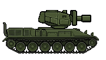
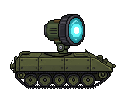
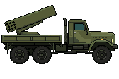

# Защитная техника

[Оглавление](../../README.md)

| Картинка | Название | Краткое описание |
| :---: | --- | --- |
|  | Пулемёт | Ствол на башне стреляет вдоль прицела. Попадание сбивает ударный дрон. |
|  | Колючая проволока | Полоса перед танком не пускает пехоту к базе и ранит её. |
|  | Огнемёт | Башня ведёт струю по дуге, на земле остаётся огонь. |
|  | Лазерная установка | Сбивает ракету или ударный дрон, которые уже летят. |
|  | РСЗО | Сама пускает ракеты в дальнюю половину поля. |
