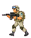
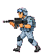
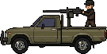
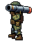
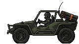
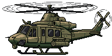

# Враги

[Оглавление](../../README.md)

| Картинка | Название | Краткое описание |
| :---: | --- | --- |
|  | Штурмовик | Идёт к базе и бьёт в упор. С 1-й волны. |
|  | Стрелок | Встаёт на середине поля и стреляет. С 3-й волны. |
|  | Пикап | Едет к рубежу стрелка и бьёт из пулемёта в кузове. С 11-й волны. |
|  | Ракетчик | Доходит до трёх четвертей поля и пускает ракеты. С 21-й волны. |
|  | Багги | Стоит у правого края и бьёт самонаводящимися ракетами. С 31-й волны. |
|  | Вертолёт | Летает над дальней четвертью поля и чередует ракеты с пулемётом. С 41-й волны. |

Урон штурмовика, стрелка, ракетчика, пикапа, багги и вертолёта растёт на 1 каждые 10 волн: на 10-й уже +1, на 20-й +2. Ниже написана база, без этой прибавки.

- **Штурмовик** — с 1-й волны. Идёт к танку и бьёт базу в упор на 12 здоровья. Убийство даёт 1 монету. У стены он взрывается, трупа на земле не остаётся.
- **Стрелок** — с 3-й волны. Останавливается на середине исходного поля (x = 640). Пуля снимает 8 здоровья. До 20-й волны стреляет одиночными раз в 1,5 с. Каждые 20 волн в очередь добавляется одна пуля, больше трёх не бывает: с 20-й две, с 40-й три. Между пулями 0,15 с, после последней снова 1,5 с. 20-я и 40-я — боссы, поэтому две пули впервые на 21-й, три на 41-й. 2 монеты.
- **Пикап** — дебют записан на 10-й волне. Сама 10-я — босс, поэтому первая машина выходит со следующей обычной волны со здоровьем 21. Дальше номер волны плюс 10. Едет быстрее солдат, встаёт на той же линии, что стрелок, и даёт очередь из пяти пуль по 2 урона, затем три секунды тишины. 3 монеты. Артиллерия, мина, РСЗО и бомбардировщик разнимают сгоревший корпус пополам: колёса отваливаются, пулемёт с кузова лежит рядом. Ионная пушка режет тот же сгоревший корпус вдоль столба, дым с капота остаётся на своей половине. Пушка, пулемёт и огонь оставляют целый сгоревший корпус.
- **Ракетчик** — дебют записан на 20-й волне. На экран он выходит со следующей обычной волны, первый раз со здоровьем 2. Доходит до трёх четвертей ширины поля, садится на колено и пускает ракету раз в 3 с на 3 урона. 3 монеты.
- **Багги** — дебют записан на 30-й волне. Сама 30-я — босс, поэтому первая машина выходит со следующей обычной волны со здоровьем 61. Дальше номер волны плюс 30. Едет быстрее солдат и встаёт у правого края поля, кормой внутрь на 6 px. Залп самонаводящихся ракет по 3 урона: две, пока номер волны меньше 10, дальше +1 каждые 10 волн и не больше восьми (с 10-й три, с 60-й восемь). На 31-й это уже пять. Между ракетами 0,4 с, после последней 3 с. Каждая выходит из своей трубки и держит свой изгиб, к танку они сходятся уже рядом с ним. Ракета задирает нос и доворачивает, за край поля не уходит. Сзади своей трубки на пуске вспыхивает огонь вдоль блока. При гибели остаётся сгоревший корпус и та же вспышка, что у пикапа. Артиллерия, мина, РСЗО и бомбардировщик разнимают его пополам, колёса отваливаются. Ионная пушка режет тот же корпус вдоль столба, дым с капота остаётся на своей половине. Пушка, пулемёт и огонь оставляют целый сгоревший корпус. 3 монеты.
- **Вертолёт** — дебют записан на 40-й волне. Сама 40-я — босс, поэтому первая машина выходит со следующей обычной волны со здоровьем 81. Дальше номер волны плюс 40. Летает по дальней четверти поля и не заходит левее трёх четвертей его ширины. Под полозьями на траве лежит тень, ниже корпуса: по зазору видно, что машина в воздухе. Несущий и хвостовой винты крутятся. Долетев до точки, зависает и дважды выпускает полный залп одного оружия. Между залпами 2 с. После последнего ещё 0,5 с, потом летит в другую. Ракеты и пулемёт не стреляют вместе: следующее зависание — другой вид. Ракеты самонаводящиеся, того же размера, что у багги, по 3 урона. Выходят по одной, между ними 0,4 с. На волне дебюта их четыре, дальше +1 каждые 10 волн и не больше восьми (с 80-й восемь). На 41-й всё ещё четыре. Пулемёт под носом крутится в сторону танка. Очередь пуль по 2 урона, между ними 0,15 с. На дебюте четыре патрона, дальше +1 каждые 10 волн и не больше десяти (с 100-й десять). На 41-й четыре. Каждая пуля выбрасывает гильзу. Ракеты сбиваются, как ракеты багги. Сам вертолёт теряет здоровье от снаряда танка, пулемёта на башне, ионной пушки и атомного взрыва. При гибели та же вспышка, что у багги: корпус падает в точку своей тени и остаётся сгоревшим остовом, на кабине огонь и дым. Ионная пушка режет его в воздухе, половины падают туда же и ложатся уже разрезанным остовом под наклоном, огонь и дым на каждой. 3 монеты.
