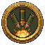
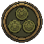
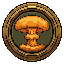
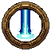
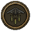
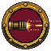
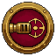
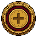

# Скиллы

[Оглавление](../../README.md)

| Картинка | Название | Краткое описание |
| :---: | --- | --- |
|  | Артиллерийский удар | Роняет снаряды в случайные точки поля. Клавиша `1`. |
|  | Мины | Ставит заряды, которые ждут пехоту. Клавиша `2`. |
|  | Атомный взрыв | Бомба в центр поля убивает всех, кто уже в кадре, и сбивает ударные дроны. Клавиша `3`. |
|  | Ионная пушка | Столб энергии проходит по полю и накрывает тех, кто под пятном. Клавиша `4`. |
|  | Энергетическая стена | Завеса перед проволокой забирает урон по базе, пока стоит. Гасит пули, ракеты и ударные дроны. Клавиша `5`. |
|  | Бомбардировщик | Самолёт пролетает над полем и роняет бомбы по одной линии. Клавиша `6`. |
|  | ЭМИ | Луч к земле в середине поля и полусфера на всё поле. Пехота и техника замирают, летящие ракеты и ударные дроны рвутся. Урона нет. Клавиша `7`. |
|  | Автострельба | Танк стреляет сам. |
|  | Автонаведение | Башня держит ближайшего врага, пока он жив. |
|  | Автопокупка | После волны сама тратит монеты и начинает следующую. |
